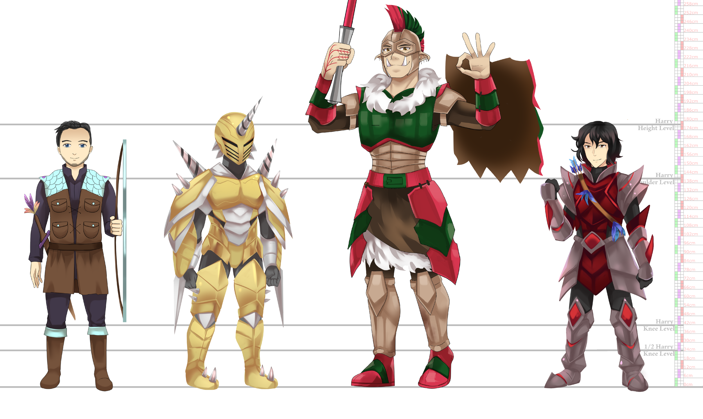

# Adventurers & Guilds

# Adventurers

Adventurers—or as some would put it—Forway's bitches on a tight leash are akin to a decentralized army composed of freelancers. A great majority of them are either indebted to a hosting guild or a private lender for the initial seed investment to gear up or cover the revival costs, sometimes getting debts from shady backgrounds, all for a simple goal! Have a better life. Some can become indebted to Forway itself, but by that point, you're already an Aquamarine or Sapphire, and debts are part of life.  
Talking about the adventurers' tiers, Forway has a firm structure of recognition, with recognitions and promotions being held on the annual Adventurer feast every Paulin 100th:  
Tier I - Pearl are the newcomers, prohibited from most jobs due to their lack of experience. Plus, Forway is not as willing to trust them either, so they are given menial tasks to improve their skills and specifically increase their soul energy, such as pest control or certain fauna hunting or flora gathering within or around cities, assisting civil construction, maintaining lighthouses, and area surveillance. In emergencies, they are relied upon as message spreaders to free up Forway guards and other higher-ranking adventurers to deal with the crisis itself.  
Tier II - Amethyst are given jobs similar to Pearls but tend to be out in the wild instead, like hunting Bagarisas. Plus, they are often used for Bounties, Bandit traps, and even some beast hunting or cargo protection. It's common to see Amethysts paired with Aquamarines since it's quite symbiotic—the Amethyst adventurer gains experience and more balls by participating in more dangerous quests while the Aquamarine saves balls as they get a higher cut of the quest.  
Tier III - Aquamarines are the ones who somehow survived this challenging profession long enough to have the opportunity to partake in even more dangerous quests, including participating in rescue parties for presumed dead adventurers to revive and stick them with an even more outstanding debt as revival ain't free! Some luck out with well-paid personal security jobs that mainly involve posturing around looking tough, while others are so addicted to the thrill of the fight they prefer to take bandit camps exterminations alongside Forway guards.  
Tier IV - Sapphires genuinely are the perfect soldiers. Their experiences alone would fill many books, so much so that it's not uncommon to have some of them turn into advisors or straight-up Forway officials when they get older. Plus, Forway itself trusts them with fully paid admission to Adventurer School if they haven't done so already, plus access to secret quests and official matters that most of their Forway guards never dreamed of being part of. It's like the old saying goes: If you see a Sapphire passing by while leading an adventurer party, then you can rest safe that they will put an end to whatever is troubling you. However, if you see a group of nothing but Sapphires, then run away as shit is about to go down.

# Guilds

##

Guilds are, succinctly, officially registered families, whether bonded by blood or not. Families use it to share governance of their wealth, properties, and storage amongst the members or just to set up inheritance ahead of time to prevent infighting—or just for the sake of clout. Adventurers often do the same but share resources, especially in larger guilds. Forway storage services are cheaper than private alternatives, but they are undoubtedly the safest. Just don't expect fast turnaround times unless you pay out of the ass!

Guilds can become famous or infamous too. A great example is Blue-Flower-Red-Bone Guild from Blood, where quite a few people will know that name was associated with the prominent sapphire adventurer Fernan Blood because they see it on his statues erected in Blood and Tastyleaf, but they might assume it was an adventurer guild, not his family guild.
