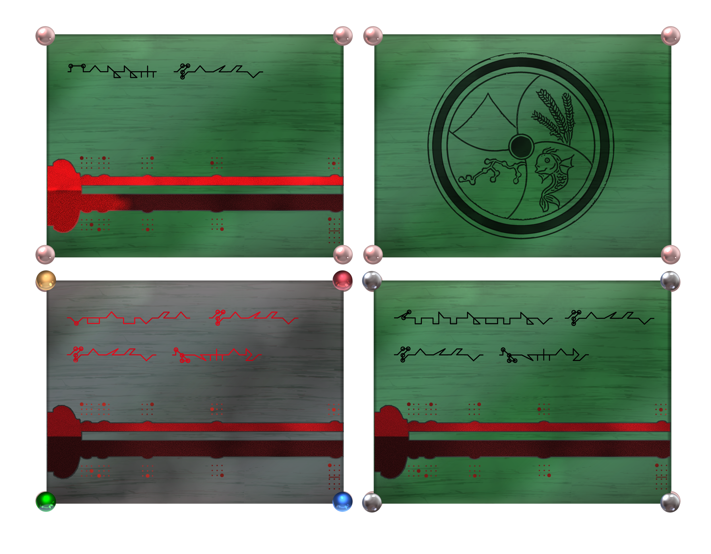

# Badges & Embassies

# Badges

The official way to prove who you are and to prove you are a citizen of a Kingdom or Forway and one of its cities is through badges. It’s possible to live without one; many do, but if you want to make any use of the plethora of the services provided by Forway and its embassies, sometimes of a given kingdom you participate in, then you don’t have a choice but to cough up some balls and pay for one. Also, don’t try to get a second badge with a different name unless you’re able to fake your very own soul. Forway has an extensive system in place to ensure you can only register your soul as a citizen once.  
The badge is normally made out of soul wood, hence its greenish color. The corners are decorated with four small peals unless you are an adventurer. Amethyst, Aquamarine, and Sapphire adventurers will have the corner balls of their badges matched accordingly.  
On the front of your badge, your name, city, and guild are displayed. That is, if you participate in a guild, but if you’re one of those types that like to be in everything to fulfill the void in your chest, then often the biggest one is chosen to be displayed—you can recraft your badge to display another guild too. Below it is a thermometer-like apparatus that measures how much Soul Energy you have. A bioluminescence only appears to the badge owner whose blood was used during the creation process.  
On the back, carved wood shows the Forway logo in black and white. If it still smells like burned wood, then you know for sure that the badge was created recently.  
Black wood Nari badges are special badges given to kingdom and city officials. Their eye-catching look will make anyone listen to what the owner of the badge has to say, even if it is followed by a punch in their smug face.

# Names

To make name, contract & negotiations easier, Forway implemented a naming schema that began with any kingdom child born after the prosperity treaty came into effect in 671 A.G.  
NAME PLACE GUILD  
NAME:   
·       Given by parents when the child is born. Uniqueness and name characteristics depend on the region.   
PLACE:   
·       City of origin or main residence.  
·       Often associated with where their primary guild is located.  
GUILD:   
·       If participating in multiple guilds, then any preferred of them.  
·       If the guild name is described as CITY-GUILD, and the city is the current place of the badge owner, then it is not written (e.g. Itagiba Sanbi Royal vs Itagiba Sanbi Sanbi-Royal)  
·       If not actively participating in any guild, this part of the name is skipped.

# Embassies

##

Embassies are opulent seven-story tall buildings planted in major Forway cities and every kingdom. Their overall dark-looking construction contrasted the accenting bright red, orange, blue, and green from the four kingdoms, even going so far as using the same specialty-made nari-glass from the Forway City palace, giving this building a unique look that doesn’t matter where you came from or where you go, you know what this building stands for, and who it belongs to—including the black fence surrounding the moat.  
If you want to use the building like any other badge-holder citizen of the kingdoms, then they will welcome you with wide open arms and a kiss! Maybe not a kiss, but you get the point. They provide badge, courier, banking, revival, guild, contract, storage, quest, and adventurer services, so this building is always packed with citizens, Forway guards, and adventurers.

  
  

There’s always at least one guard mounted in a big winga flying around, but do be wary that big winga is another forway guard who transformed himself into a big winga, so they are much wiser than the beasts—if you have somehow seen one given their pretty much extinct nature.
Also, don’t forget the cutesy wingas tirelessly traveling back and forth between embassies, carrying vital information, love letters, and of course, gossip and shit posting all over the land. They are not known for spying on the contents of letters, but if you’re up to no good, you should obscure the messaging just in case.

  
  

On the subject of doing no good, the building is filled with riches since that’s where the Forway taxes and banking deposits are accumulated and transferred to/from the Forway palace. However, think twice, maybe three times, about getting your grubby hands on it as the embassy land, even though it might be inside a kingdom, is still entirely under Forway’s jurisdiction. And don’t bother using your slivery tongue to talk your way out if you get caught fucking with them, as the supremacy of the Prosperity Treaty protects the embassies and the guards—even if they went as far as pulling your intestines out, wrapping your feet with it, then throwing you from the open fifth floor for an exclusive bungee jumping experience.

They are so strict with it that it doesn't matter if you're a Sanbi guard that found themselves in the wrong place. Your king or queen won't be able to move a finger despite the Forway embassy being inside the Sanbi Kingdom. You will be Sanbi shit out of luck. Same for any other embassies.

# Embassy Captains

##

The utmost authority of the given embassy they are in. They have the utmost authority if the embassy is in a city managed by Forway. Otherwise, the embassy grounds are their utmost authority, with the kingdom the embassy is located in belonging to whoever owns it. They have been essential in maintaining stability and an overall sense of peace and prosperity ever since the Prosperity Treaty was created. With that stated, you will only see Aquamarine or Sapphire Forway captains in those positions, as Forway officials must trust their own future to them.

Some become loved, some become feared, and sometimes both, depending on who you ask, but either way, they all work towards that one goal.

Now, why would someone of such stature be dressed like a guard, with only a fancy cap to differentiate them? It's simple, really! Forway enforces all the generals' armor and social clothing to be the same as soldiers to ensure they remain aware of where they came from and the impact of all their actions, as it's easy to get lost in the numbers and make a decision that seems good on paper but creates a strain in the relationship between the kingdoms, or people, and Forway.

# Embassy News

##

Embassies are also responsible for being the news source and relay for Forway (and in some aspects for Kingdoms as well). They have a classification for news events, each costing progressively more than the previous one:

Type 1: General

The cheapest one. Usually done by people looking for specific things or just wanting to brag about something. Kinda turned into a marketplace for odd things over the years. Your info will be posted on the general board and the weekly Forway News printout. Whoever wants to read it or ask a guard for info will have an opportunity to see whatever you posted. Sometimes Pearl Adventurers will check this board, but don’t count on it. 

Type 2: Local Warning

Missing People, personal protection, etc. Usually, all quests are classified as Local warnings. The usual “Pay to Win,” or rather, “Pay To Be Heard.” Your thing will be posted on the Quest board, which is where Adventurers are far more keen to check out. The captain will also announce all open quests/news of this level on every Monnalow. Some companies/traders advertise their wares at this level as well.

Type 3: Kingdom Alert

Has the Buhraies castle decided to spill a bunch of undead garbage once again? Has a Kingdom official been taken hostage? Do you have a lot of money and want something done quickly, or do you want everyone to know about it? Then this is what happens when you pay out of the ass for news. Alongside the quest board and shouting at Monnalow, the captain will immediately send a shoutout across the kingdom's main cities/villages to gather all available adventurers to assist with your request (if necessary) or just shout out the news as-is.

Type 4: Emergency

For when shits the fan, such as an external invasion or an army of Hifuna monsters, somehow decide to march down towards Forway. This has never happened since Forway was established, so it’s just a news type in theory. Some higher-ups in Forway even pushed for the removal of it since it costs resources, keeping every embassy at the ready for an emergency level of alert (which most likely aren’t.) It includes being able to staff at least a hundred adventurers with lodging, food, and fighting resources within three days, be able to defend itself from a Tier X spell, etc.
