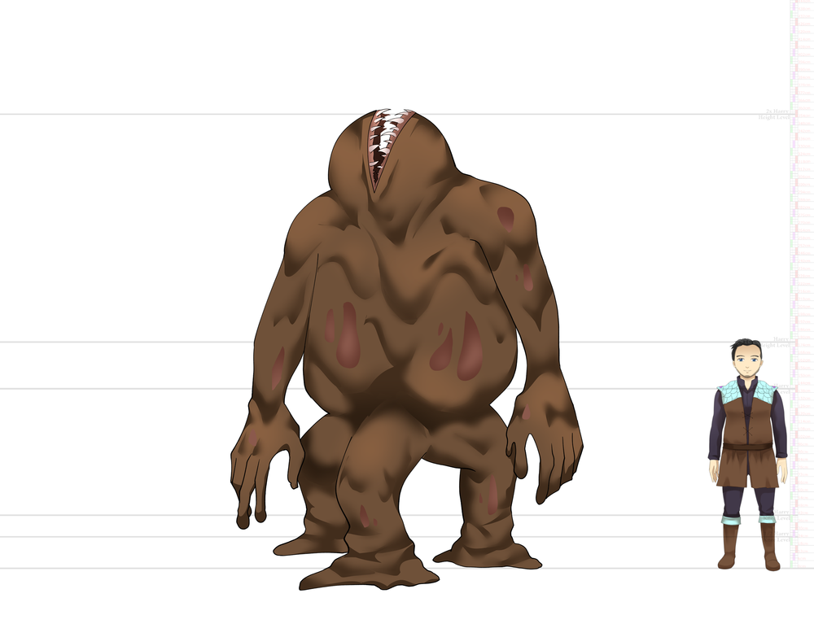

# Beasts

# Big Wingas

Big Wingas are beasts! Say that to a room of scientists, and you surely spark conversations with a reasonable possibility of it evolving into a shouting fest or maybe, just maybe, a full brawl. They are another result of Buhraies messing with wingas and flingas, at least that's reasonable to expect, as the likelihood of this thing coming into existence on its own is pretty low, given their ancestry split off into their distinct taxonomic family quite a while back. What is curious about these creatures is their intellect being advanced enough that some scientists will put their reputation on the line to say they are a race like the cruros, not a beast like the bruntos. Others say it opens the door to a slippery slope, and soon nari worms are a race too, and being given badges to become citizens, and then everyone is fucked because grounded nari prices will go up because nari worms will control the market.    
Rants amongst scientists aside, big wingas are unfortunately near extinct, if not outright extinct, in the wild for all intended purposes. Their delicious meat and beautiful large feathers led people to hunt them down until the big wingas somehow survived to learn to eschew everything and everyone.   
However, families of people who stole eggs and raised them instead are now swimming in balls selling nari gel of them. They don't really sell adults for others because they grow so attached to people, but if you put in the time and effort, you can buy a big winga egg and raise one yourself—if you have the balls to pay for one, and if you can even find one as this species is not known for being the frisky type.   
At least it's not rare to see their beauty with your own eyes, as you can see Forway guards using them, but that's a guard wearing nari gel, so don't expect them to act bird-like. It is safely assumed they carefully keep their flesh preserved and replicate nari gels from it, or they have a breeding stock nobody knows about it. Either way, they are tight-lip about it.  

# Bruntos

Bruntos are a glimpse of the endless curiosity and tampering mindset of the ancient Buhraies race. Not only content in messing with plants and the land itself, but they were also as far south as Endlessfog, altering the local ecosystem to their will until Lishies wrecked the place up and tried to eat anything that moved in the whole island. That's what historians say, but scientists are still perplexed about how they created an entirely new species out of thin air. Nothing close to Bruntos other than Naked Bruntos also called humans, existed—not even in Newland. Some scientists speculate that this is substantial proof that our physical bodies are interconnected to a soul plane and that other planes of existence are also connected to this shared soul plane—this must be how Buhraies connected flesh to the soul and brought us all here. Other scientists say these scientists need to lay off the Magina and stop getting high at their jobs. Either way, Bruntos makes great companions!   

# Crazed Muckman

Crazed Muckman is not as "crazy" or "man" as the name implies. They all come in all sorts of shapes and sizes, sometimes with extra feet, arms, or even triple the torso size, yet they all have a similar look and, most times, are not particularly aggressive—as long as they don't see you as food or you don't muck with them. Urban Folklore says these beasts are "born" when a shapeshifter eats a shitty bandit corpse, but scientists haven't been able to prove that. The current growing hypothesis is that these things are the—maybe natural—evolution of shapeshifters because of the environment around Blood and Freeish.  

# Flingas

Flingas are massive beasts that fly high up in the sky, rarely ever coming close to the ground. Nobody knows where these beasts nest their younglings—if they even do that. Their complete lack of migratory patterns and sometimes random flight patterns, like flying over a specific city for days, still baffles all scientists and historians to this day. There are tales by the campfire surrounding a sapphire adventurer that wore Big Winga skin to fly back home, and on the way, he saw what appeared to be a child-sized wood humanoid riding on top of it. Some Scientists suspect it was a child of an ancient species called Fuhraies; others state it could be Finaies, another ancient species rumored to live north of Hifuna. Attempting to capture a Flinga is also damn nearly impossible as not only do they quickly climb higher at any sight of danger, but they can also use their soul energy interface to stun enemies with a few attacks, including unfathomably high-pitched screams and air gust streams.  

# Hifuna Wood People

Hifuna People are like the crazy cousin and are proof that Hifuna will fuck anyone up, including something as sturdy as a tree. They will slice and beat everything in their sight, including their own, to a mashed potato consistency, then squat on top of it to absorb its nutrients into itself. Wood People could also do that, but no one has seen them do it. It's a grim fate fighting these beasts; a Sapphire adventurer will have to be quick on its feet to evade how much soul energy Hifuna People pour into their interface—their attacks are much stronger than Wood People's, plus additional skills in the vines like making sonic booms, creating razor sharp edges, and creating spikes that it launches towards you at not to be scoffed at. Don't forget the exploding branches too! It can tear them off itself and chuck them toward you in desperation. On the plus side, Hifuna Yabucas sells well on the black market! Not that we condone doing so, of course—  

# Koalin

Koalins are truly a unique breed of beast; some scientists still dispute whether they should be categorized as beasts in the first place. They don’t really bite, claw, or kill people. What they do, however, is far worse! Through the unique special wave generation organs in their head, alongside the white silky white beard that focuses those waves towards a target, they can strike virtually anyone with strong mental impairment. If they are just being defensive, they can make you feel a looming doom, a fearful sensation, but if they amp up the intensity, they can lead weak-minded people to kill themselves. If you resist that, they will increase the intensity to debilitating pain. There’s no winning against a Koalin. They are also nearly untamable, but if you manage to tame one, they are inseparable and will earn you reaches you never thought possible!  

# Nari Worms

Nari Worms are native to the underground caverns below Blood. Despite their threatening look and massive size, they are quite amicable to everyone, even when you find their eggs. Avoid the curiosity of eating them or harming these worms in any way, or you will be in deep shit if Forway finds out. They are so protective of these creatures that they are not afraid of using the worst punishment in the books, including being shipped out to Hifuna. It is certainly harsh, but it is fair as nari stones are a byproduct from the shed skin of Nari Worms, and no other creature or scientific process can accumulate this much soul energy in a ready-to-use form.  

# Sand Worms

Sand Worms are native to the deserts around Gandew and must be the absolute worst creature from that region! They are always either burying themselves below the surface or cloaking themselves in plain sight, then viciously attacking unsuspecting victims. Luckily Saynas often detect them to turn the tables and allow adventurers to hunt them instead. It's crazy how some Darfaries still refuse to use Saynas and instead prefer to get high on the thrill of being attacked at any moment; it's pretty gruesome seeing a Darfaries and a Sand Worm duel to the death.  

# Shapeshifters

Shapeshifters are presumed to be one of the last remaining ancient species in this world. They are intelligent, have forethought capabilities, have an interface with a wide range of actions, and can even communicate in the shape of the creature they are mimicking. However, a growing group of scientists is classifying it as a beast instead, as all of its apparent intelligence is just another form of mimicry because, at the end of the day, its communication skills show that it is nothing other than a mindless blob, seeking to grow large enough to divide itself in half. Or the shapeshifters that got captured are the dumb ones. Who knows? Although tavern gossip about it floats around once in a while, such as a specific shapeshifter that more than once approached lonely male adventurers with a distinct hole in the middle that they felt was perfectly lubricated and warm. Some seemed flustered when asked how they knew that, while others stated they interacted with it recreationally.  

# Sucker Lady

Sucker Lady is exactly as the name states! The origins are suspected to be similar to Crazed Muckman, with the difference being a shapeshifter eating a whore instead of a bandit. The jury is still out on whether this is a natural evolution of the shapeshifter to its environment, but not as it matters that much at the end of the day. What matters is that you should keep watch of your surroundings at night, especially if you start to feel followed. For some reason, they are picky with their targets, sometimes lurking around them for days before attacking. If you do get attacked, do know they will pin you down to suck at your soul through any interface they can, usually people's fingers since it's connectors to the darfaries interface. You can use a fost lamp to drive them away or give something else finger-shaped for it to suck on...  

# Sweet Sting

Sweet Sting is found west of the Freeish Kingdom, with SweetLake being their HQ of sorts. They can be heard quite away, their wings making a deeper buzzing sound as they carry pollen or tree sap back to make black honey—an extremely nutritious yet diabetically sweet paste. It might sound threatening, but that's just a female worker passing by. They don't have stingers like their smaller male counterparts, but their pinchers are still quite powerful! If you see black flames emerge from their pincers, get ready as they are about to shoot a poisonous spit that gets accelerated to near sonic speeds by their soul energy interface. Don't count on evading because they never seem to miss a shot! There's even a common phrase in the local populace, I'm sure as a spitting Sweet Sting.  

# Teefyro

Teefyro baffles scientists and makes many disagree if this thing is a beast or fauna. It definitely lacks any formal intelligence as it rampages around aimlessly, sometimes even killing each other through the usual process of exploding its gums and sending its teeth as a projectile—sometimes killing itself in the process by bleeding to death, or in rarer cases, the interface controlling the explosion goes full haywire and detonates the entire body, leaving a crater where the beast once stood as a shower of blood and guts precipitates the whole area. It also randomly casts different spells through its flesh composition of the diverse fauna pieces and other beasts. Scientists still aren't sure how many combinations there are, but if it has something akin to teeth that explodes outwardly, and its body shape reminds, or at least smells like a Bagarisa, then for sure, it's a Teefyro.   

# Trunk People

Trunk People are native to heavy, thick forests around the Freeish Kingdom. They are easily recognizable by their four arms, with each being able to show different colored flames, including altering their intensity. The name Trunk People is an old name, for scientists now know they are nothing but parasites! Still, they are cute and can even recognize faces. You see them everywhere in Freeish and surrounding communities as public light sources and even as security for some because their flaming and blinding capabilities are pretty impressive for their size. Some can also respond to certain body motions and training, often becoming part of shows and traveling bands.   

# Walking Flathead

Walking Flathead, or simply Flathead. All textbooks keep it simple: If you see one, you're fucked. Everyone at this point assumes they are the Bahyum castle's leaders, acting like its physical manifestation. How many are there? Nobody knows. What species did they transform from? Nobody knows either. What some do know is that whatever the fuck this thing is, it must have been part of the reason Buhraies lost control over their own castle, holding countless scientific experimentations, and likely also a factor that forced them to withdraw into Gandew Mountain. What adventurers and guards do know is that if you manage to kill one and drag its body to a seller, you can live like a king for a whole year. Odds are not on your side, so most likely, you will become a walking flesh and then walking skin for eternity—think of the plus side! You will become part of something greater than yourself! Just like working a corporate job!  

# Walking Flesh

Walking Flesh is the common name for any species stuck in this half-state thing. They are undead and seem to share some hive-mind cognition, but they don't seem completely devoid of their intelligence either. If they are taken far away from the castle, some transformed species will rampage against anything; some will idle, while some even demonstrate docile behaviors. The transformation does compound on the behaviors, so the more they are transformed towards the walking skin version, the more they lose whatever remains of their sanity. Don't underestimate their fighting capabilities; you might just become one of them.  

# White Roundies

White Roundies are gentle mammals from the far south known as Whiteland, often coming up to the shores of Freeish but sometimes as far as Sanbi during the winter to feast on their heart, given the winter in Whiteland is far colder than the Four Kingdoms' winter. Don't let their cute nature fool you, though! They are incredibly intelligent, with some scientists dedicating their lives to investigating their culture alone. It is commonly accepted that this beast is likely on track to become their own race in the far future, but people disagree on what is the turning point. For some, the fact we can't understand their language is the most significant differentiator from Cruros. Others fight that argument on the grounds that they might be even more intelligent than us, and we don't understand them. Others think this whole back-and-forth is a waste of time and prefer to play catch, rub their bellies to hear the rumbling noise that sounds like a pur they make with their neck sensory tentacles, or straight up make companions out of them. If you're one of these people, there's a whole festival around their arrival in Freeish Kingdom you cannot miss out on.  

# Wood People

Wood People were, amongst many other things, another one of Buhraies experimentation gone wrong—or right. The debate of what they were trying to achieve is still a hot topic, but historians at least agree that Buhraies somehow wanted to make them foot soldiers plus a stable source of food and lumber. Meanwhile, scientists still can't fully wrap their heads around how they engineered a tree to be able to unearth itself and walk around in packs, let alone control its vines to defend itself. They did figure out that Buhraies used fost stones to paralyze and control Wood People based on specimens and tools found throughout the ages. Now they could be considered a plague as they are absolutely everywhere in the Buhraies Plains. Entire villages exist solely to strip these beasts for resources, with good prices going for their fantastic rubbery vines! That is if you can cut them off, as they won't go down without a fight. If you get a beating, you can at least sink your teeth into a nearly head-sized tasty Wood People Yabuca to appease your emotional wounds.
