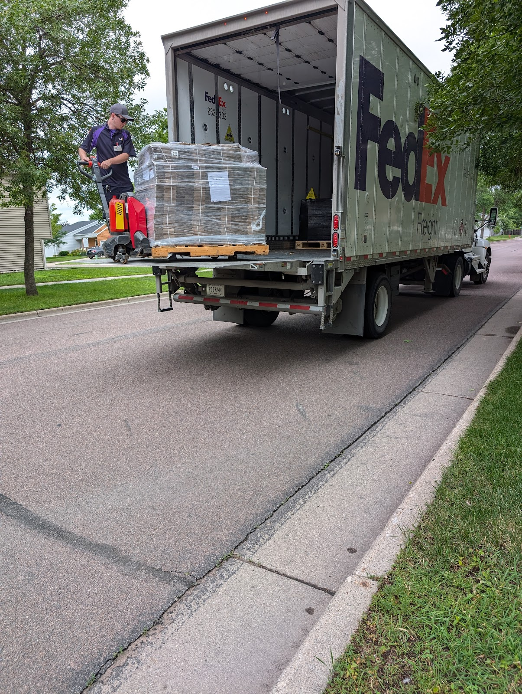
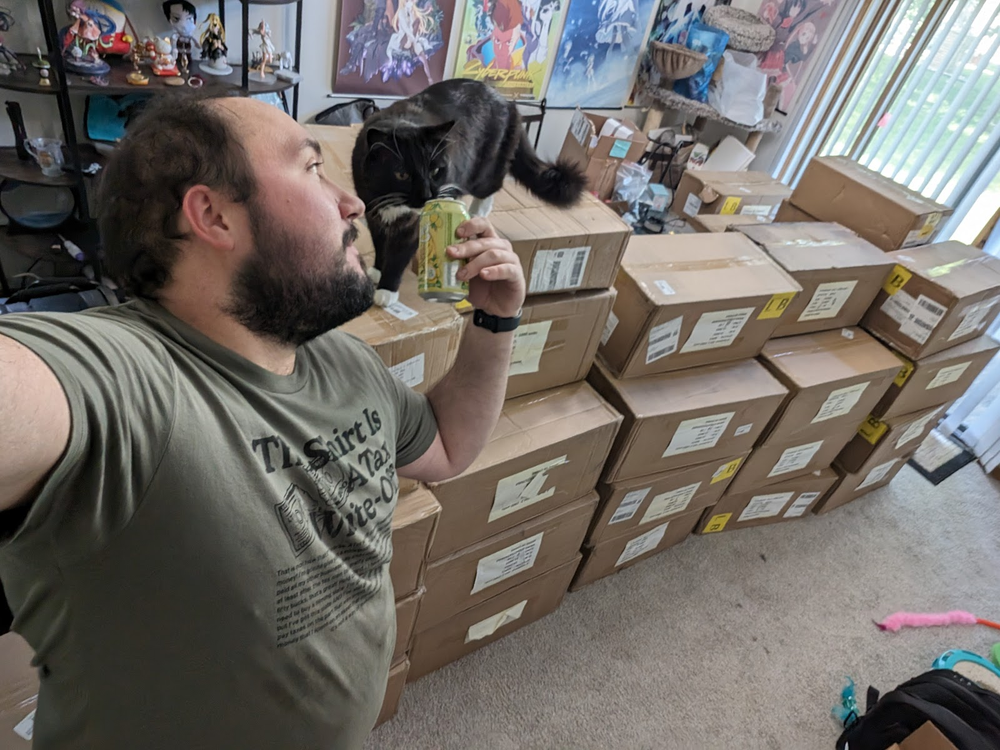
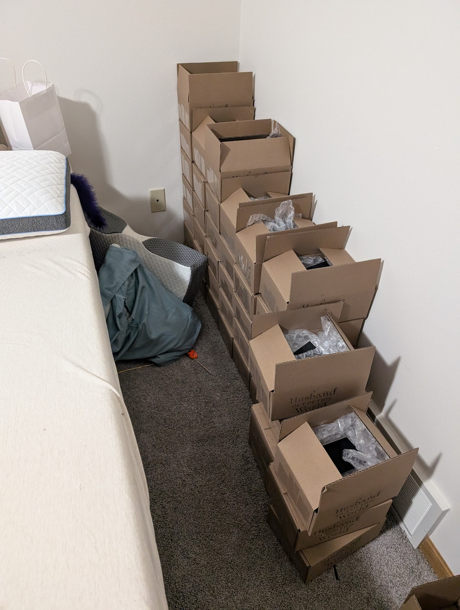
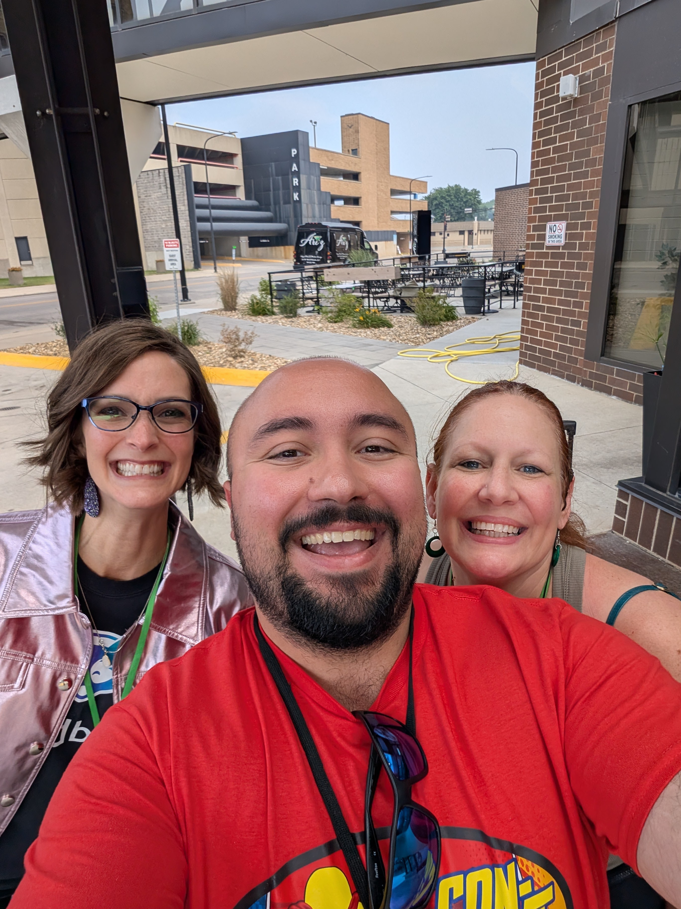
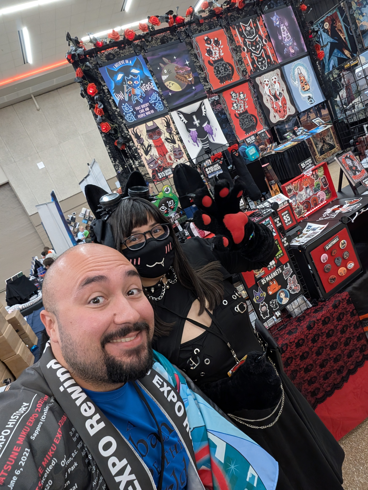
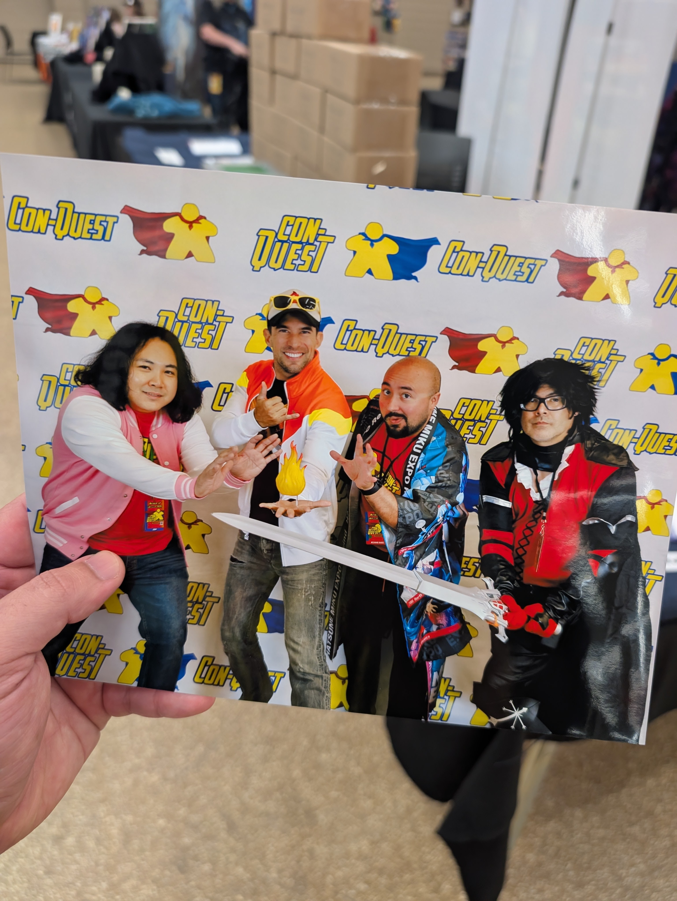
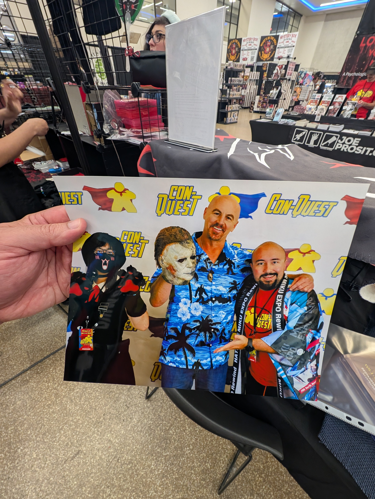

# Blog

Every journey comes to an end! Come with me down memory lane :)

  
  

The first blog post on the #HusbandOutWorld blog was back on Feb 19, 2022. The vivid dream that started it all was back on Oct 15 2019… Today is June 16th, 2026, and 57 blog posts later, I’ve decided this is the final one.

For everyone who followed our journey: a heartfelt Thank you! Obrigado! Terima Kasih! Gracias! Arigatou! from my two illustrators and me! And Peeta too!

As of this post, all internal docs are public, except Vol 4, which we're actively working on.

https://github.com/Deovandski/HusbandOutWorld/tree/main

That will be released later this year, and with that, we will finish the series after 7 years of work! The Deo who started this series is long dead, because the one writing this final message has grown massively from it. This series changed my life. It forced me out of my introverted shell and to face my deepest fears. And now, the Deo that lives and breathes has the massive balls to jump out of a plane and even pose for a photo 1,500 feet up in the air…. Hella good times!

To my illustrators, this has been an awesome journey, and I’m so glad I made such awesome friends I can trust deeply!

To everyone who read the story, hope you enjoy the shenanigans!   
  
-Deo

  

