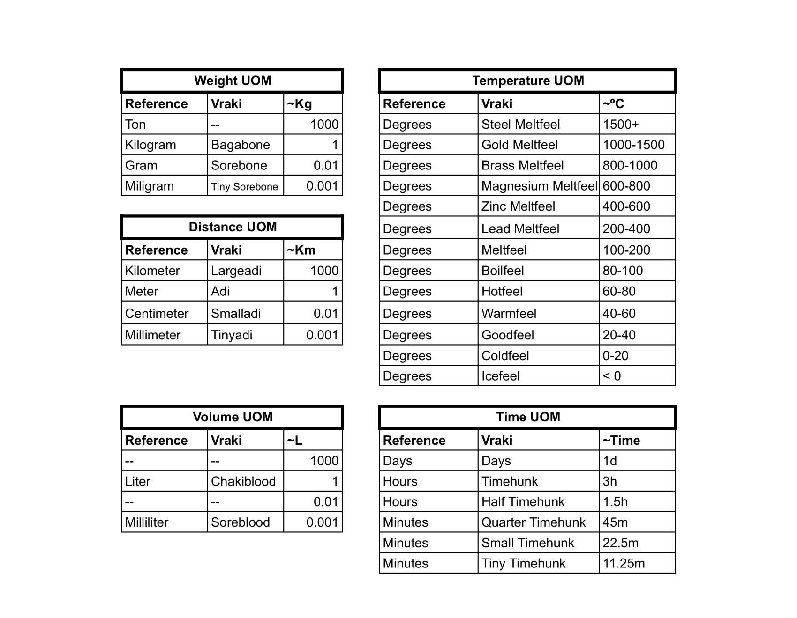

# Economy & UOMs

## Balls Currency

Balls are the standardized currency as determined by the Prosperity Treaty. Each ball is about the size of a marble and is encrusted by the golden circular metallic decoration that protects the mineral inside and makes it harder to counterfeit or tamper with.

The most common currency is Pearls, which denotes the currency's minimum value. For reference, on an average working day, a gatherer of Gyut (a berry akin to Acerola) would earn one pearl per kg of berries picked (around thirty minutes to one hour of labor, depending on their efficiency.) Assuming a newbie gatherer worked for twelve hours, they would likely pay five pearls for a simple but hearty dinner with a mug of cheap beer, then another five for renting a humble hostel bed, with two pearls left over to save for tomorrow. Usually, one would use pearls for food or standard simple services like wagon rides for relatively short distances.

If you gather fifty Pearls, then you can trade it for a single Amethyst. Some books can be as low as a single amethyst if the janky ass printing presses back at Forway work well, but most people would use their amethyst to buy household items like fost lamps or live animals like a tamed Winga or pay their rent. Some clothing can be found for a few amethysts, but don’t expect them to be a pussy (or dick) magnet. You could skip the flatteries and just go to a brothel after drinking a few beers instead of not paying much attention to what you’re stuffing or being stuffed by. If you want to use your balls on something else instead, buy some nari gels, nari stones, or better lodging!

And if you somehow saved ten amethysts, then you can trade for a single aquamarine. You fancy! Don’t walk around showing it off, or some miscreant might request a “compulsory loan to keep you alive! You could buy a small egua for that price! Or even a tamed Big Winga! Or you can invest in yourself by enrolling at a local fundamental education school to open the door to new opportunities. If that’s not your thing, then you could do all the things amethysts can, but fancier. Fancier clothing, fancier hoes, and fancier beer too. Some people’s life savings amounts to one or a couple of aquamarines, so

You somehow got ten Aquamarines? Damm. You could trade that in for shiny Saphire. This is the scale of balls where you can obtain specialized education for you or your children. Depending on their worth, you can have someone bend to your will with life-long contracts in the tens if not hundreds of sapphires. Or you can buy properties and even guilds! The world is yours! But depending on where you go, you will need to hire adventurers to serve you as bodyguards, as some miscreants will love to have a chat with you. Or wear fake skin, and none would be the wiser.

## Vraki UOMs

Before the Prosperity Treaty, Kingdom UOMs were all over the place, making trading harder and opening the door for sketchier traders to forge papers to evade authorities and rip off customers. Adrian, one of the courtroom scientists that overthrew all rulers at the end of The Greed Period, saw the treaty they were establishing as an opportunity to standardize all measurements based on using the most accurate one in existence—which happened to be the Tolerideme Kingdom, coincidentally where he was from. Gandew, of course, still uses their own to this day alongside the Vraki measurements. In contrast, everyone else's historical measurement implementations are now the type of knowledge that only historians care to know.

\*The name Vraki is a homage to ancient texts that portrayed Buhraies working hard to unify language across species.
