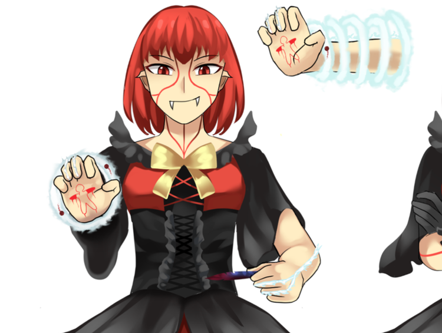

# Science - Buhraies Interface

## Buhraies Interface

A "fleshy" focused evolution to the Finaies interface! Its capabilities outgrew Finaies in raw power and eventually led Buhraies to force themselves to become powerful enough to reshape the land and other creatures to their liking.

## The “Veins”

All Buhraies show the markings of controlled flight and built-in spell-casting mechanisms using specialized nerves attuned to soul energy that appear as veins, at least to the untrained eye, throughout the body. These reddened nerves run up and down their body.

Despite lacking the distinct capillary branching appearances of the Darfaries interface, all Buhraies are better at controlling flight and speed than anybody else! They can even hover at will!

## Using The Interface - Setup

You must carve the logograms into the skin of one of your palms, then clench your fingers to start the interface while keeping the palm visible.

That is, unless you’re doing a freeform! You will not have the pain of carving your palm, but it might cost your soul or the souls of people around you. Despite Buhraies having a natural inkling for controlling free-forming, including being able to shape the very land to their will, that same power was likely their demise.

## Using The Interface - Startup

Now you must make a fist with your other hand. If you can use this interface, a distinct group of five rings will surge from the white flames in your arms and expand outward, with the smallest ring closer to your wrist.

## Using The Interface - Feed

Then stick out your middle and ring fingers and touch them on the logograms of the open palm.

Instead of fingers, you can use nari stones sticks to feed power without using yours, or someone else's, Soul Energy.

Keeping your fingers clenched on the hand you used the logograms on, you must now trap the fingers, or nari stone stick, then reverse the motion while keeping the fingers clenched. This sort of “eating“ motion will suck the power and create a ball into one of the rings that will temporarily hold power. Do not worry about how fast it zips around. The rings will keep it in check until you release the spell in the final step.

To add more power, repeat this action. Be aware that each “eating“ motion attempts to bring the spell to the next stable tier, or energy level, so awareness of the increased soul energy needed between each higher tier is essential.

The rings themselves can only hold so much, although as far as everyone knows, nobody except probably Buhraies or perhaps only the primordial species Finaies could cast such a spell at a world-changing scale.

Ring #1 (closest to wrist): 2

Ring #2: 8

Ring #3: 18

Ring #4: 32\*

Ring #5 (closest to elbow): 50\*

\*At least that’s what scientists calculated, as no official Forway record of an exceedingly high-tier spell being cast exists.

## Using The Interface - Release

To release the spell, unclench the fingers. To add motion to the spell, cock your arm, then throw it towards the target to transfer the inertia into the spell.
