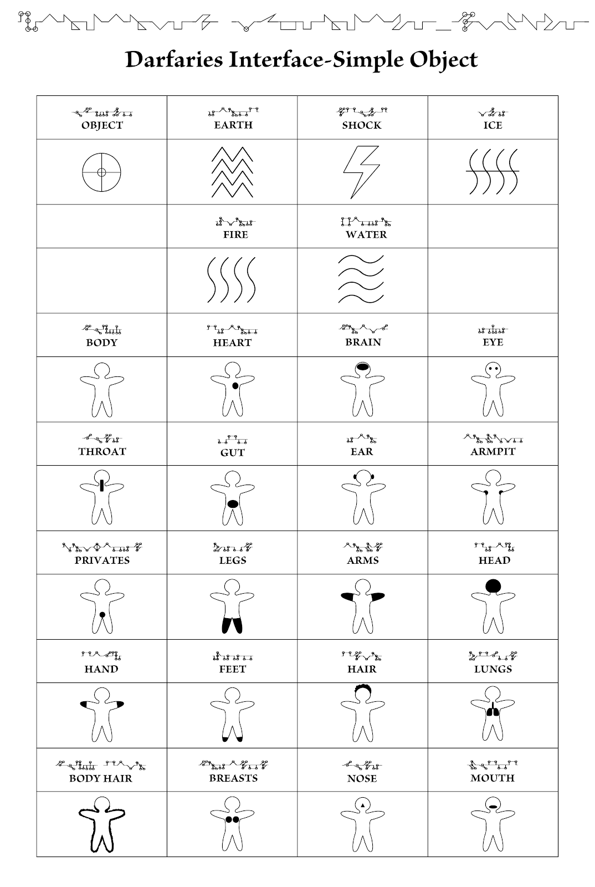
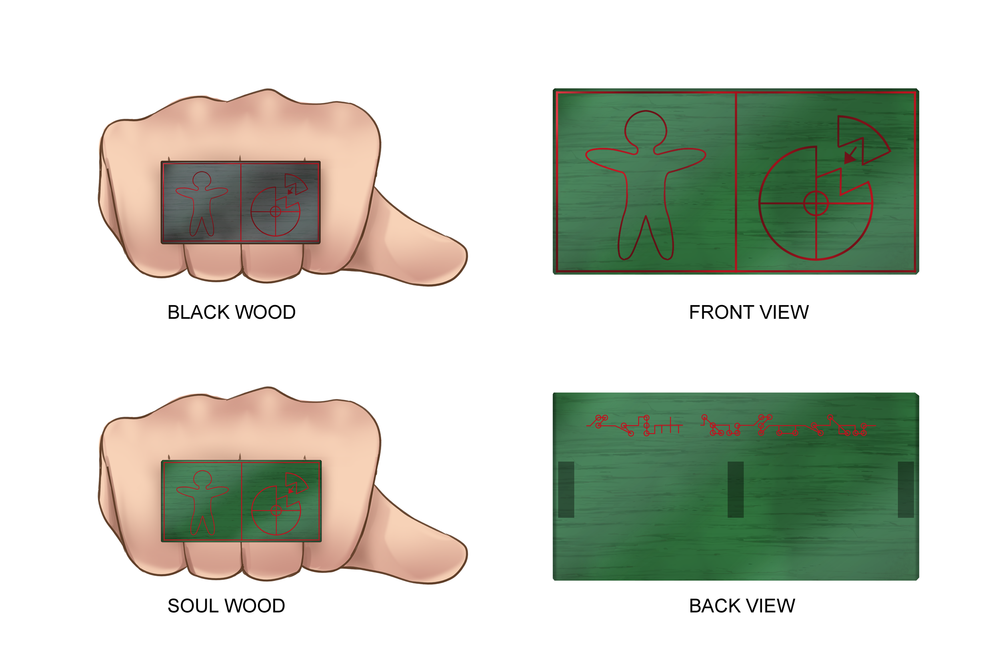

# Science - Darfaries Interface

## Darfaries Interface

This widely-known interface came up as a merger between the ancient species Fuhraies’s, Buhraies’s, and Lishies’s genetics and their own interfaces. One would assume that would lead to one of the most potent, versatile interfaces that would be as, if not more, powerful than Buhraies interface. In some ways, it is as it gels incredibly well with sigil rings or drawing logograms on it, as you don’t even have to think about it once you get the hand coordination just right. However, this came at the expense that if you do not draw a logogram, it is nearly impossible to control it.

The interface itself is broken down into two logograms: OBJECT and VERB.

## Simple Objects

Currently, 26 Simple Objects are widely accepted, as in Forway-approved, for Sigil rings. They are mostly inherited from previous interfaces and haven’t changed in hundreds of years.

Forway considered banning non-logogram usage of this interface in the early 800s A.G., but the scientific community's pushback was too strong. Community opinion shifted in the early 900s A.G. after many scientific tragedies occurred without clear progress. By the late 900s A.G., only fringe scientists like Gabiro Sundeath (also known as Gabiro Sanbi Royal) seemed to be still investigating it.

## Compound objects

This is where some progress has been made in extending the interface framework! Nobody has successfully transformed the OBJECT and VERB structure of the interface—but they have been able to increase the information density of the object while retaining consistent casting.

It has been a while since Forway approved a new compound object for sigil rings. There is a single requirement, but succeeding is incredibly tough!

It is a simple trial in which random passersby are asked to use the experimental sigil ring. If any result is a miscast, the compound object is not approved.

## Verbs

This is where some scientists spent their entire lives trying to claim a new verb to be accepted by Forway, but all their works became food for paper rot and forgotten to history because of a single man who broke through the hundreds of years stalemate.

987 A.G, the one and only Gabiro Sanbi Royal, landed the formalization of Darfaries interface verbs and the addition of both Transmute and Entangle by creating a new version from the older interfaces. You could say he stole Right, Up, Down, Left, & Rolls from other scientists claiming it, but he was the one who created a uniformity that no other scientists had in mind, so he took home all the glory.

Such a feat did claim a lot of street creds among scientists but also a lot of enemies. Not enemies in the traditional sense, as we’re talking a bunch of nerdy scientists that fight with pens and papers rather than bloody means… Except for some who tried to get physical with Gabiro, but when he was younger, he was not as defenseless as one might expect from a shut-in.

## Variant Verbs

If you see one of those in a sigil, then for sure it was manufactured before 987 A.G! Some even collect those as trinkets, which increased their price, which then brought fakes to be manufactured. Seeing the shitstorm developing, Forway officialized production of the old versions, which dismantled the market for it, and the problem was solved! Still, lots of people were pissed, but at least it stopped the grift.

## Interface "Balls"

As you feed a specific command and energy into the interface, you will see balls representing the command. You can never mix and match commands; only one command + energy + release may be executed. Below is a plain reference of the different ball statuses

  
  

## Using The Interface - Setup

Using the Darfaries Interface is a process of its own. Though, like riding an egua, once you learn it, it just becomes second nature.

You must apply the logograms to the skin of one of your palms, or use sigil rings, then clench your fingers to start the interface while keeping the palm visible.

## Using The Interface - Startup

Now you must make a fist with your other hand. If you can use this interface, a distinct group of five rings will surge from the white flames in your arms and expand outward, with the smallest ring closer to your wrist.

## Using The Interface - Feed

Then stick out your middle and ring fingers and touch them on the logograms of the open palm.

Instead of fingers, you can use nari stones sticks to feed power without using yours, or someone else's, Soul Energy.

Keeping your fingers clenched on the hand you used the logograms on, you must now trap the fingers, or nari stone stick, then reverse the motion while keeping the fingers clenched. This sort of “eating“ motion will suck the power and create a ball into one of the rings that will temporarily hold power. Do not worry about how fast it zips around. The rings will keep it in check until you release the spell in the final step.

To add more power, repeat this action. Be aware that each “eating“ motion attempts to bring the spell to the next stable tier, or energy level, so awareness of the increased soul energy needed between each higher tier is essential.

The rings themselves can only hold so much, although as far as everyone knows, nobody except probably Buhraies or perhaps only the primordial species Finaies could cast such a spell at a world-changing scale.

Ring #1 (closest to wrist): 2

Ring #2: 8

Ring #3: 18

Ring #4: 32\*

Ring #5 (closest to elbow): 50\*

\*At least that’s what scientists calculated, as no official Forway record of an exceedingly high-tier spell being cast exists.

Video versions

Applying command

  

Feeding energy

  
  
  

## Using The Interface - Release

To release the spell, unclench the fingers. To add motion to the spell, cock your arm, then throw it towards the target to transfer the inertia into the spell.

  
  
  

## Controlled Flight

Due to their size, Darfaries cannot fly, but they can somewhat dampen their fall from approximately three-story buildings. Wozefaries can dampen their fall from up to ten-story buildings, while Sorefaries can control their attitude at will, and even carry some weight with them. The weight depends on the Sorefaries’ strength, dexterity, and soul energy capacity.

When attempting to control their flight or dampen their fall, a white flame appears on their Darfaries’ veins. This flame becomes black as its strength changes, constantly adapting to the user's desire to balance or propel themselves through the air. The sensation is close to a jetpack as they use their arms and upper back to control it while their feet dangle freely. It requires training and emphasis on building core and neck muscles to maintain control.

## Shared Blood

Not to say humans can’t use this interface. They certainly can! Although, only if they have shared blood with Darfaries or Wozefaries in their family.

To not have any significant amount means you likely came from a bloodline that lived far remote or perhaps outside the four kingdoms, as free commerce and right of passage are perfectly positive correlations with mixing biological fluids between species.

Most humans living in the new millennium of 1000 A.G. can be considered a new subspecies of intermixing Darfaries and Wozefaries with Naked Bruntos—a.k.a humans according to Darfaries. Interbreed humans can use this interface despite all lacking the same protruding nerves. Some show characteristics of the distinct Darfaries’ floppy ears and more prominent tusks, but only in sporadic cases. This has created friction in the past and still does to this day as Darfaries, especially ones living in Gandew, refuse to interbreed with humans to avoid losing the traits that are so part of their racial identity.

## The “Veins”

Darfaries, Wozefaries, and Sorefaries show the markings of controlled flight and built-in spell-casting mechanisms using specialized nerves attuned to soul energy that appear as veins, at least to the untrained eye, throughout the upper body. These reddened nerves always ran up their hands and arms and met in the back with a distinct capillary branching appearance.

Given Darfaries sport the most prominent Darfaries veins, its sheer additional volume allows them to finely sense soul energy disturbances around them, plus a rough sensation of humidity, wind, and barometric pressure—it’s like how they say, if a Darfaries tells you to buy an umbrella, you better buy one!

Environmental changes, especially creation, destruction, and manipulation of elemental properties such as water, fire, terrain, and gravity, are commonly performed through this interface.

Healing is also often performed through this interface due to its abundant nature or as a way to heal a living soul being affected by the nari gel interface without resetting its effects, as one interface cannot reset or manipulate another interface.

## Sigil Rings

Sigil rings are a modern and quicker way to interact with the Darfaries Interface. Without it, one must draw the logograms into the skin of their palm, which can be a lengthy process, even for seasoned adventurers. Dangerous, too, as if you draw something unclear as it could cause the interface to default to your thoughts, and you needlessly turn your best friend into a fanchaki all because you thought about what’s cooking for dinner while casting it. And if you’re really messing with the soul, even if by accident, you might never find a way to undo it.

But hey, at least your best friend might be honored to be stuffed and cooked—vorarephilia is a thing anyways.
