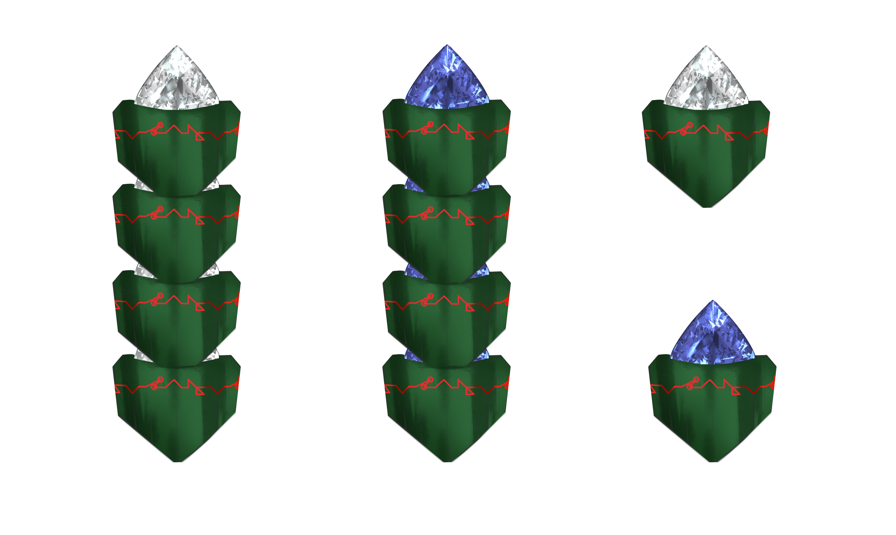

# Science - Nari Bombs & Stones

## Nari Bombs

Nari bombs, by the name alone, sound quite scary, but it all depends on how it was made. Sure, they can be made to explode violently when in direct contact with water, which makes them great for traps or just chucking at your enemy while someone else lunges a water ball, but most nari bombs being sold are tamed so that they only emit a lot of smoke instead.

Still, don’t drop it in a lake, as there’s only so much safety against dumb people a manufacturer can do—use Create Mist instead, you dumbhead! Well, unless you’re trying to see how cool the explosion looks because it’s a sight to behold. Actually, here’s a trick! Wrap it in paper so that the explosion is delayed a bit! That way, the water's top will explode out much more intensely! You didn’t hear it from me, though.

Adventurers had a variety of colors they used, sometimes varying per region or per guild too. It created a lot of confusion to the point Forway intervened and officialized these colors:

Red: Help.

Cyan: Conquered/Complete.

Green: Safe/Go ahead.

Yellow: Retreat.

These colors are used by everyday folks too, and even more so by adventurers. However, Bandits are people too, so they use it to get you into a trap instead. Be wary if you see it randomly, but remember as an adventurer, you’re representing Forway! You should still check it, though, as it could be a test for your promotion. You never know! If anything, you can kill a few miscreants and loot them instead—to surrender it all to Forway for investigation. Yes! Exactly that ;)

## Nari Stones

Nari stones are an everyday item that powers many facets of society, as it basically acts like a battery for soul energy. When filled, it gives off a bluish hue that looks relatively liquid, as if it were trapped inside the stone. When used, it changes its looks to a diamond-like appearance, showing a hollow look.

In its most available and ready-to-use form, it is a stone encased by green wood that can protect it from leakage or unplanned discharge. Each stone can be chained into another to form a “nari stone stick. “

The stone, or more precisely speaking, processed nari worm scales, is also available in its grounded form and can be used to infuse soul energy into some interfaces like Darfaries interface, or items such as mixing it with blood and sealing it inside a badge crafted by Forway embassies.
