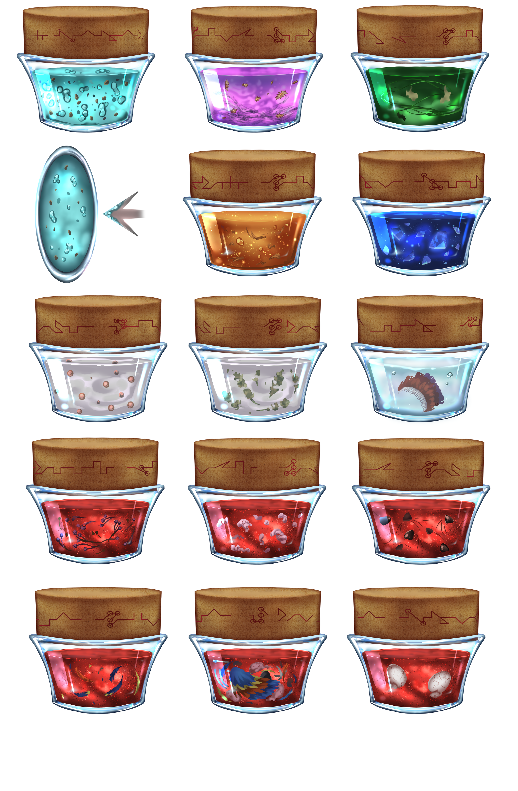

# Science - Nari Gels

## Nari Gels

  
  

Nari gels are the quickest and safest way to perform actions on any living soul, as they are ready to be consumed or injected, and their tiered effects are easy to reproduce. Ground nari dust is infused with water to create a jelly-like consistency, which you mix with other substances and possibly some catalysts to achieve any effect. The coarser, cheaper grades of nari gels make it easy to consume, but their transformation effects tend to be more painful and slower. You can pay a premium for very fine-grade nari gels that make it easier to inject, especially if you want to reduce the pain as much as possible.

A wide range of nari gels fulfills most poisons, body, and mental status modifications. From changing your eyeballs to the same of someone else who has better vision than you to completely transforming yourself into a Big Winga so that you can soar the skies freely! The fact that they are tiered means the difference between smoothing your skin versus melting it off as you suffer the worst imaginable pain and scream to someone to end your life can be just three scoops away from one another.

On the plus side, your liver will eventually process and expel the nari gel changes, so if you are solo and put yourself in jeopardy, sit back and relax! If you don’t die from it, you will eventually be able to get back up and do it again! On average, the coarser, cheaper stuff tends to take longer to be expelled, so consider this. Either way, do it enough times; your body might start to accept the changes as a new reality, changing your meaning of normal forever.  It won’t be cheap unless you get high on your nari gels.

Scientists, usually alongside businesspeople, try to outperform each other with the latest and most extraordinary recipes. Unfortunately, this market has gained the reputation of being cutthroat. Sometimes, the neck-breaking research speed or shady cost-cutting in testing can lead to unaware buyers being “alpha-testers“ of new products and their claims.

Everyone buys these gels, with adventurers usually buying more than commoners. A wise adventurer will always have a nari refresher ready to be consumed to reset all afflictions caused by other nari gels—unless said adventurer is using fake body nari gels to alter their personality, which is not unheard of, but definitely not recommended.

## Bleed Out

Made from ground Nari with dried Panita mushrooms and Bagarisa blood. Effects range from blood thinner to bleeding from the ears and eyes (usually used for a good prank or theater plays) to full-blow hemorrhage. Many subversions exist, such as controlling the heart rate of the victim.

## Body Paralysis

Wood Apple seeds alongside finely ground Cinika give this nari gel its notorious yet beautiful look. From a simple numbing feeling, growing to difficulty moving, losing control over limbs, or the ability to breathe or your heart to beat, this nari gel offers a lot depending on the dosage. Subversions usually focus on the quickness of the effects, combining effects with other nari gels and avoiding tainting the meat as much.

## Cruro Skin

Mixing Cruro's hair and skin will give a nari gel that, depending on how much is consumed, will provide you with something as simple as thicker greenish skin to a scaly lizardy skin that hampers agility. At least mosquito bites will be a thing of the past. Some subversions exist where it doesn’t tinge your skin green.

## Egua Privates

Like the name says! Made from ground Nari with Egua scrotum and blood. Some slice it up or grind it, but other subversions have it whole and make you swallow the testis. Depending on the dosage, this might give you an impulsive sex drive that you might rip your clothes off and lunge yourself at the next livable thing walking by. Some subversions focus on the penis length and shape instead, in case you need a boost or just trying to compensate for your soul genes, not birthing you with the extra inch of confidence. Other subversions focus on the ball size or load quantity in case your kink is ejaculating a literal bucket... After all, scientists creating these nari gels are doing 101 economics by simply supplying the demand.

## Mind Enabler

Forbidden by Forway, so expect to pay out of the ass in the black market. It is made from ground Nari with Koalin brain matter, eyes, and mustache mixed with its own blood to make it extra nasty. The effects of the Nari gel will be different for every person, even if given the exact dosage, which is rather unheard of in this interface. Ranging from a drunken, forgetful, or enabled mind state to memory loss, personality changes, or full-blown blackout, this nari gel, in the wrong hands, can make its prey do all of its worst bindings! The worst part is that the person afflicted by it might not remember a single thing that happened, but some still have that feeling of doom or suffer PTSD with trigger items despite not knowing why. Scientists believe this nari gel affects the soul-flesh connection.

## Nari Refresher

Molten Nari worm shells mixed with tons of ground Nari stone and sweet lake water. It serves as an antidote or reset to cleanse any effects caused by this interface on the body. As you drink it, you can feel a particular gasification reaction in your mouth, going down your throat and continuing on your stomach. The bubbly feeling disappears once it finishes reacting with the salt in the body and resetting and restoring your current flesh genes to match your soul genes—albeit the restoring part is not as efficient as Body Restore from the Darfaries Interface.

## Skin Melt

This one has been a controversial Nari gel over the years. It is the best laxative out there in low dosages as it makes stuff move without giving you the infamous cold sweets and urgency to run to the nearest bathroom like your life depended on it. It also works to melt hair away when applied topically. The controversial aspect is when the dosage is increased to melt your skin and flesh away, making it so painful that it works excitingly well as a torture tool if you are a cruel maniac. Currently, Forway bans anything but the watered-down versions of it, but that doesn't stop you from condensing it down to its proper form; hence, some are pushing for a total ban.

## Time Quicken

Made from ground Nari with Soul wood seeds mixed with Cocona water. The seeds are not ground on most offered versions because most people prefer slowly releasing their effects on the body. From a warm "wake-up coffee without the need to poop" feeling to get through a busy day, to triggering a constant fight or flight, to having the feel that time around you slows down, or to extremes of tearing your body apart and triggering a brain aneurysm, this nari gel can overclock your body to the point your brain quite literally explodes. Plenty of custom versions exist to tweak what needs to be overclocked or compensate for any downsides of it. Virtually every adventurer depended on one of these to get through a tough battle.

## Time Slower

The opposite of Time Quicken. Made from ground Nari with Steen mixed with Cocona water. Tier I (Cosmetic) brings you relaxation, sleepiness, and the munchies. Some variations also add muscle relaxation or avoid giving the munchies as you could be on the road and need to pass the time in the wagon but have limited food supplies. Tier II (Localized) certainly decreases your alertness and often comes with a slowed heartbeat and reflex. The lethargy at this point is only comfortable to a few people, so you rarely see anyone consuming enough to get into this and above tiers. However, if you do, then expect Tier III (Regional) to be a challenge even to stand up and walk around. You might still be lucid enough to think clearly, but you will be mumbling your speech and slop around like someone on the verge of being black-out drunk. Tier IV (Whole Body) relaxes your heart, too, making it take a nice long nap that softly kills you.

## Water Breath

This one is pretty straightforward. Fish gills mixed with ground nari and water, and there you go! You can breathe underwater! Well, it's more complex, actually. Depending on the quality of the nari gel, gills develop on the back, near the lungs, or on the sides of the neck, impacting efficiency. Tier I (Cosmetic) usually results in Malformed gills on the person slurping this gel, causing them to be unable to breathe air or water quite right or eat properly. Tier II (Localized) does come with better water breathing. The skin might become slightly scaly, and the person must swim to breathe underwater while no longer being able to breathe air. Some custom versions figured out a way to still allow people to breathe air, though expect to pay top balls for it. Meanwhile, Tier III (Regional) gives you far more efficient water breathing while costing you any remaining air-breathing, with some versions allowing you to eat again. Some nari gels worsen scaly skin or give core temperature regulation issues, while other variants will enable you to stand still while the gills and other structures pump the water through. Tier IV (Whole Body) typically allows one to breathe even in swampy, less oxygenated water, but you might become more fish than human... In other words, your breath goes glub glub.

## Winga Flight

Dreamt of flying freely like a Winga, but your physical body is of a mere human? Or do you want to get from point A to B as quickly as possible with barely any cargo? Then slurp a "tasty" Winga Flight potion and see your bones lighten up, your fat and flesh transform into pure muscles, and all of your hair transform into beautiful feathers the more you drink it. Please don't drink too much, or you will get a beak! Your vocal cords will also change to allow you to sing at notes you never imagined you could do before, though at the cost of enunciating the Vraki language becoming an indistinguishable mess. If you keep drinking it, you could develop issues processing higher thoughts as your physical brain will reduce in size as well. On the plus side, you can't worry about stuff if you're a literal birdbrain. It is not unheard of for people to give up on everything and become a cute Winga, but the longer you stay as a Winga, the more your soul will get corrupted, and with enough years, you will be unable to return to what you once knew yourself as.

## Winga Skin

If you want all the benefits of the beautiful Winga feathers minus the pain of having your bones and flesh transformed to take flight, then this is what you need. Most of this is sold in Forway for festivals or for kinky stuff, where "stuffing" takes a whole different meaning. Some use it to create a natural barrier against the mountains' bitterly cold, brutal winds while retaining the humanoid insides. Still, go all the way to Tier IV, and the number of feathers is so great it will be a challenge to see, eat, walk, and sleep, but at least you will be just as warm as chilling out on a sunny beach.

## Wooly Skin

Wooly skin and hair mixed with just a bit of wooly milk and nari gel will give you silk-smooth hair that grows even faster and rarely splinters. Hands down, it's one of the most used and customized nari gels around! You can even tweak the hair color you have grown and even where it will grow if you shell out enough balls. Add more potency to it, then you might get way more hair than you ever wanted, if not making your nails as thick as hoof. That's when sane people would stop the dosage as anything beyond will only worsen it, such as clumps of hair plugging up your nose and producing such grease hair that it feels like you were covered in lard.

## Wozen Smell

Made from ground Nari with Wozen nose and whiskers. It's a simple but effective nari gel, also officially known as one of the first nari gels ever created at some point during BG (Before Ganyrami's fall.) Still, customizations do exist, such as creating spatial reasoning of the smells, preventing brain overload by narrowing the range, or tampering with the sensitivity, usually done to find a specific someone or something. Other customizations cost a lot more; in exchange, your brain becomes fully adapted to the flood of info the Wozen nose can pick up, making you a formidable predator. Whether you go cheap or expensive, you must be careful as you can become too sensitive to things like perfume that can cause you to have nosebleeds, be sickened, vomit, or even go into comatose.
