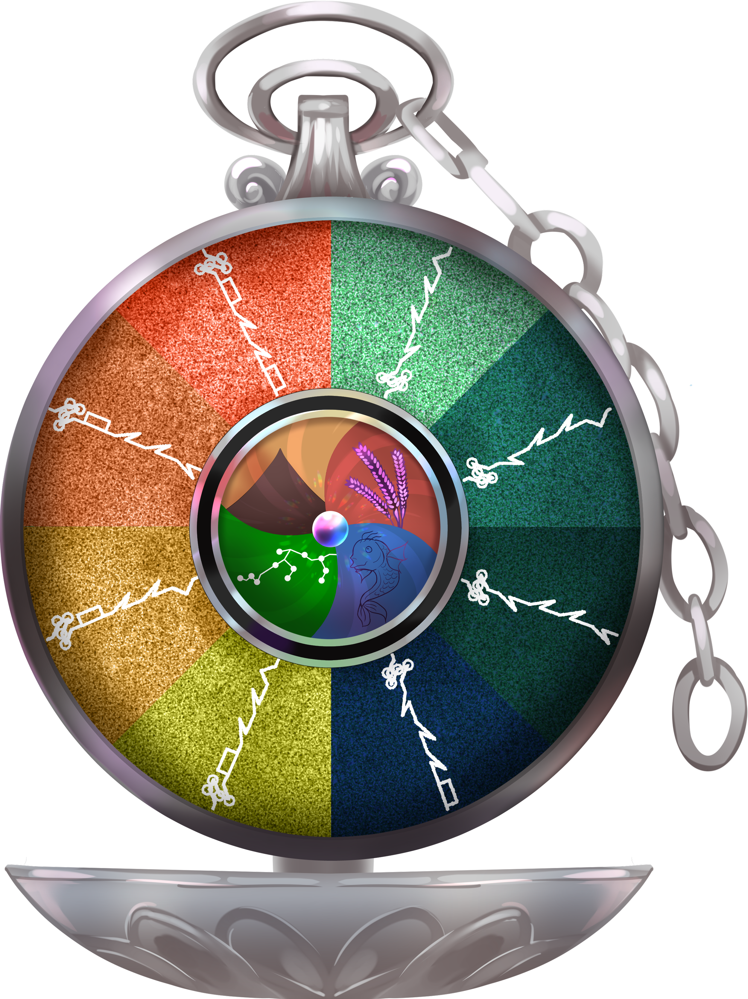
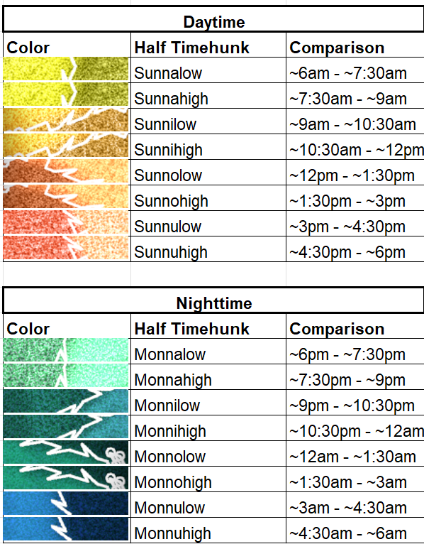
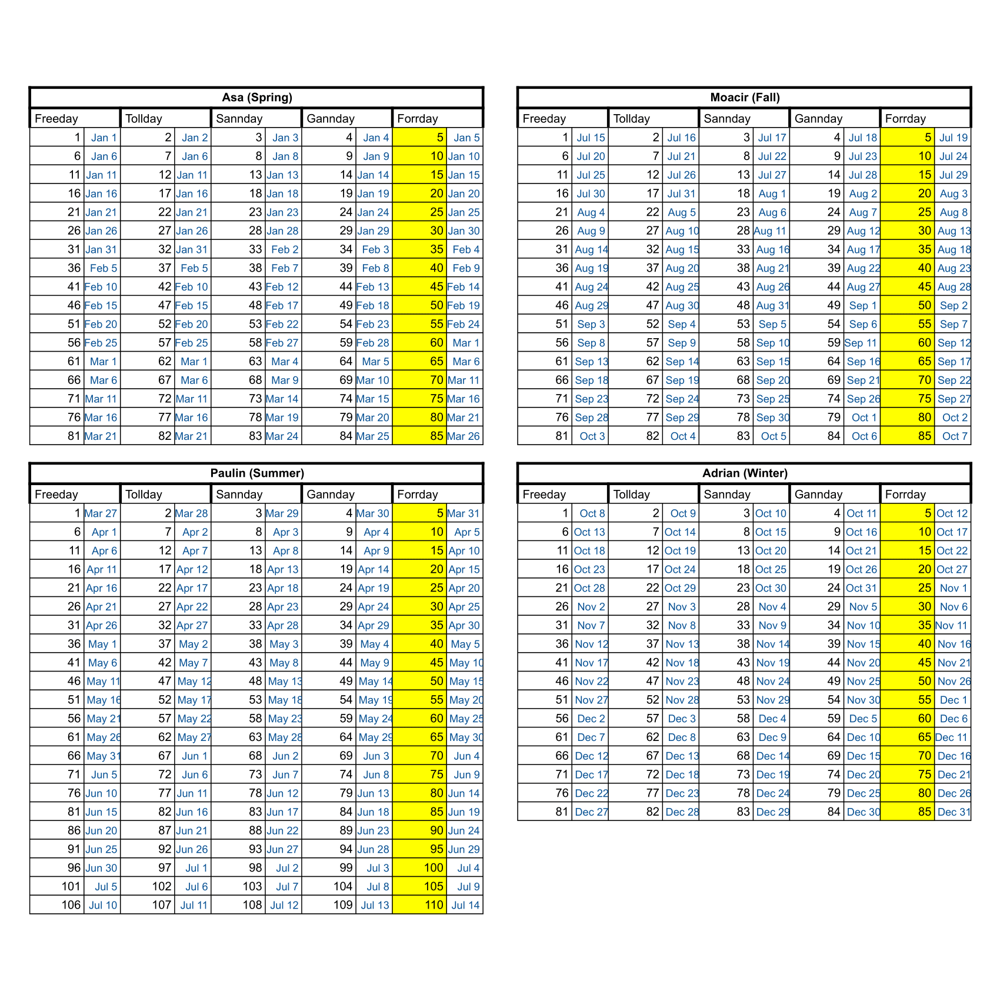

# Time & Calendar

## Time Keeper

Akin to a sundial, the Time Keeper tells the time of day by shining it with sunlight or moonlight. Shortly after, you will be able to tell the time based on which section is growing bioluminescent.

To read the Time Keeper properly, start from the bottom (6 o’clock), where the separation between yellow and navy blue sections represents sunrise. The entire yellow chunk is Sunna, equivalent to a timehunk, or about three hours. The Vraki writing within it breaks down the timehunk into half timehunks called Sunnalow and Sunnahigh.

Going clockwise from the start (6 o’clock), you would read out the time as follows:

Sunnalow, Sunnahigh, Sunnilow, Sunnihigh, Sunnolow, Sunnohigh, Sunnulow, Sunnuhigh.

The edge between red and light green (12 o’clock) represents sundown, and if you continue to read out clockwise, the half timehunks are:

Monnalow, Monnahigh, Monnilow, Monnihigh, Monnolow, Monnohigh, Monnulow, Monnuhigh.

  
  

Time can be further divided into quarter, small, and tiny timehunks, but one would use a Time Counter (akin to a sand clock) to do so, as day-to-day interactions are often expressed as “Let’s meet at Moonahigh for some fun time.” 

Kingdom’s culture over how close they keep track of their Time Keepers varies substantially. The most common example is that Sanbians are rarely on time, while Toleridemians are unnecessarily punctual.

## Vraki Calendar

The Vraki calendar was adopted as the official calendar when The Prosperity Treaty was signed. Adrian, who spearheaded standardizing UOMs, also assisted in creating a standardized calendar. Wanting to immortalize themselves, he found a way to split a year amongst the courtroom scientist that created The Prosperity Treaty.

The start of the calendar is determined by the fall of Ganyrami; hence this new era is called After Ganyrami (A.G.), and everything prior to it is called Before Ganyrami (B.G.)

Each day of the week is named after one of the respective kingdoms, with Forrday being named after Forway and declared the end of the week (weekend).

On every Asa 1st, Forway also releases a lunar mapping for Hunters, farmers, adventurers, and others that depend on the lunar phases to gauge environmental tendencies for a measly twenty pearls.

\*A mapping to the Gregorian calendar can be seen in blue.
