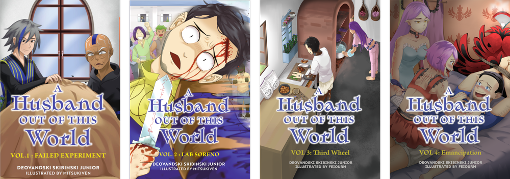

# Graphic/Light Novel Series

# **Arc #1  - Dubious Contract**

  
  

A botched soul experiment leaves a stranger reborn in a high-magic, agnostic world without memory of his past. From a bloody fight ritual with a princess to a conflicted scientist driven by carnal ambitions to the shackled souls navigating the shadows of a brothel—each character shapes his path toward self-discovery and emancipation.

## Vol 1 - Failed Experiment

A stranger awakens buck naked in a bloodied room with barely a sense of self, only to be greeted by a lively royalty that offers him a brutally ritualistic marriage proposal to Maiara Sanbi Second-Princess. The offer seems worth the price of admission when King-Maid explains the caveats, but she doesn't know the full picture either, for something much darker is brewing on the horizon.

**Chapters**

Chapter I - Unexpected Aftermath

Chapter II - Stranger

Chapter III - Being Fair

Chapter IV - Suspicion

Chapter V - Being Friendly

Chapter VI - Fate

**Vol Size**

~51,000 words, 204 pages with 28 full-page color illustrations

**Store Links**

[Amazon](https://www.amazon.com/dp/B0BT5XM4QC?binding=kindle_edition&qid=1656361003&sr=8-1&ref=dbs_dp_rwt_sb_pc_tkin) | [Bookbaby Shop](https://store.bookbaby.com/book/a-husband-out-of-this-world-failed-experiment)

## Vol 2 - Lab Soreno

A lifetime of boring servitude as Sanbi-eye now awaits Harry after dying at Maiara’s hand, but something inside just never felt right ever since his first night at Sanbi Castle. Perhaps the sexual assault was just a vivid nightmare of his previous life, but as he reflects on it in the soul realm while reviving, the facts all come together in his mind. Will he figure out what is looming on the horizon before it’s too late? Perhaps it is already too late, for not even the king-maid truly knows the queen’s machinations.

**Chapters**

Chapter I - What if?

Chapter II - Sanbi-eye

Chapter III - Fake Eye

Chapter IV - Lab Experiment

Chapter V - Growing Remorse

Chapter VI - Lab Passion

Chapter VII - Buhraies Research

**Vol Size**

~59,000 words, 213 pages with 30 full-page color illustrations.

**Store Links**

[Amazon](https://www.amazon.com/dp/B0BT5XM4QC?binding=kindle_edition&qid=1656361003&sr=8-1&ref=dbs_dp_rwt_sb_pc_tkin) | [Bookbaby Shop](https://store.bookbaby.com/book/a-husband-out-of-this-world-failed-experiment)

## Vol 3 - Third Wheel

Harry's journey of self-discovery has been rough, reaching a new low when he resigned to be Eori's lab rat. Will he renew his will to fight for his freedom? Meanwhile, Arukia, supposedly just a young maid hired by the King-maid for being eye candy, will be taking a sudden long PTO. Perhaps she smelled something fishy with all the events surrounding Harry. What will she discover if she keeps digging into the Sanbi Eye's disappearance? And will Kibe, the apprentice courtroom scientist, ever be able to find a way to rebind Gabiro's soul to this mortal plane so that he can blame him and have him fix everything like the good old times?

**Chapters**

Chapter I - To Kibe

Chapter II - Brewing Suspicion

Chapter III - PTO

Chapter IV - Scientific Child-making

Chapter V - Cockblock

Chapter VI - Big Momma

**Vol Size**

~39,000, 184 pages with 31 full-page color illustrations.

**Store Links**

[Amazon](https://www.amazon.com/dp/B0BT5XM4QC?binding=kindle_edition&qid=1656361003&sr=8-1&ref=dbs_dp_rwt_sb_pc_tkin)

## Vol 4 - Emancipation

Two Wozefaries girls are being tasked with extracting the truth surrounding the explosion and Gabiro's sudden demise from Harry. Will they become his way out of this whole mess and take the opportunity, or will he falter and seek Eori's warmth? Meanwhile, Arukia has jeopardized her steady Sanbi maid life to fulfill the end of the contract that gave her that mundanely peaceful life in the first place. What will she do now? And Eori and Neferteri have had their precious Lab Soreno stolen. How will they respond?

**Chapters**

Chapter ? - ?

**Vol Size**

?

**Store Links**

Available Q2 2027
