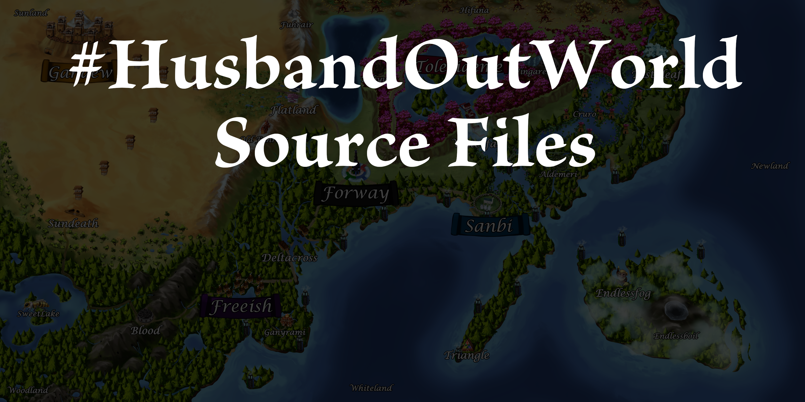

# A Husband Out Of This World

## SPOILER WARNING!

This repo makes everything behind the #HusbandOutWorld series available. EVERYTHING!

Want to see a website version with less spoilers? Check out 
[HusbandOutWorld.com/world-lore](https://www.husbandoutworld.com/world-lore)

## 

### Spot something wrong, or want to make a change?

Create an issue or feel free to send a PR!

### Are you a D&D DM and want to have fun with our World Lore?

All D&D content now lives in the [Vraki West March Campaign](https://github.com/Deovandski/Vraki-West-March-Campaign-D-D) repo: an open-table West Marches campaign set in this world, with a World Lore summary, travel rules, quests, stat blocks and ready-made adventurers. If you host a campaign, let us know! Love to see pics!

Also, we hereby authorize you to stream and earn money from streams and 3D Prints using the source files located herein, as this is a transformative use of our copyright. We do request that you credit us.

### Are you an artist, illustrator, etc?

Feel free to peruse. If you have any questions, let us know. We’re open for collabs and crossposts!

### Are you a publisher?

Want to reach out to the author? We’re open to a copyright/trademark transfer for an Omnibus vol or other publishing ideas, including a new version through a ghostwriter. Email deovandski@outlook.com for more info!

### Want to use the Vraki font?

The Vraki typeface in [Logo and Font](Logo%20and%20Font) has its own [license](Logo%20and%20Font/LICENSE.md). Non-commercial use is free with attribution. Commercial use needs approval and a fee, kept small for artists and creators to support the community; ask through [HusbandOutWorld.com](https://husbandoutworld.com/). Please don't alter the font without permission.

© Deovandski Skibinski Junior. Licensed under CC‑BY‑NC‑SA‑4.0, except the fonts in Logo and Font (see [LICENSE.md](LICENSE.md)).